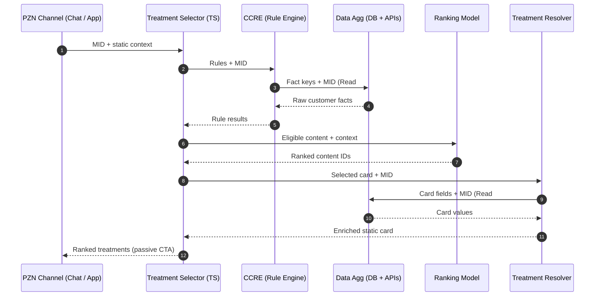
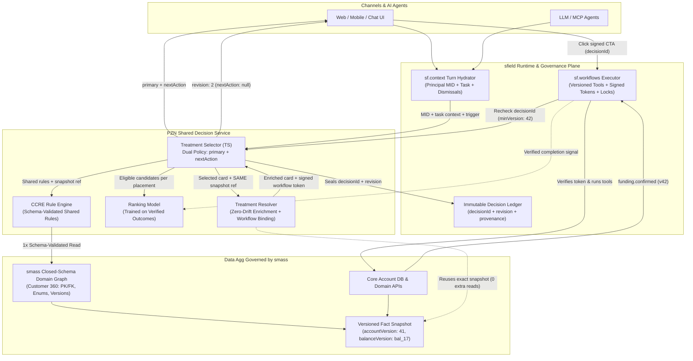

# Architecture Proposal: Re-Anchoring PZN as the Enterprise Agentic Decision Plane with `smass` & `sfield`

> **Executive Summary:** Personalization (PZN) is at strategic risk of being bypassed when channel and AI teams build LLM agents that call domain APIs directly. This proposal modernizes PZN's existing 5-component stack — **Treatment Selector (TS)**, **CCRE**, **Data Agg (Customer 360)**, **Ranking Model**, and **Treatment Resolver** — by introducing **`smass`** (closed-schema relational domain contracts & versioned fact snapshots) and **`sfield`** (governed workflow execution, context hydration, signed actions, and compliance audit ledgers). Rather than competing with AI agents as a static content picker, PZN becomes the **mandatory Decision, Eligibility & Action Control Plane** that every channel and AI agent calls.

---

## 1. Strategic Context: Why Teams Try to Bypass PZN Today

| Friction in Current PZN Flow | Why Agentic Teams Want to Work Around It | How `smass` + `sfield` Solve It Permanently |
| :--- | :--- | :--- |
| **Static slot / context silos** | Duplicating one eligibility rule (`account.funding_status == unfunded`) across `address-update`, `pending-actions`, and chat contexts slows every change. | **Dual-Placement TS + `sfield` Context Hydration**: Publish **one shared rule** (`first_deposit`), evaluated independently in `nextAction` across web, mobile, chat, and AI agents. |
| **Double Data Agg reads & fact drift** | CCRE fetches facts from Data Agg to evaluate rules, and Treatment Resolver fetches Data Agg *again* to enrich the card — causing latency and eligibility-vs-display mismatch. | **`smass` Versioned Fact Snapshots**: Data Agg issues one schema-validated Customer 360 snapshot (`accountVersion`, `balanceVersion`) reused by both CCRE and Treatment Resolver. |
| **Passive cards with dumb links** | Agents want executable, multi-step next actions (e.g., funding preview), not static marketing copy. | **`sfield` Signed Workflows**: Treatments bind versioned workflows (`account.funding.preview@1.0.0`) sealed with HMAC tokens tied to `decisionId` + `MID`. |
| **Stale recommendations after action** | Cards stay on screen after a customer completes a deposit or update until a full reload. | **Event-Driven `decisionId` Revisions**: `funding.confirmed` advances Customer 360 to `accountVersion: 42`, triggering TS to emit `revision: 2` (`nextAction: null`) live. |
| **Unverifiable LLM suggestions** | Risk & Compliance cannot approve raw LLM recommendations with no deterministic rule or data-version audit trail. | **Tamper-Evident `sfield` Decision Ledger**: Every `decisionId` seals CCRE rule outcomes, `smass` data versions, ranking scores, and verified workflow outcomes. |

---

## 2. Current vs. Target Architecture

### Current PZN Architecture (2× Data Agg Reads, Static Content Delivery)



### Proposed PZN + `smass` + `sfield` Architecture (Single Snapshot, Executable Workflows, Live Revisions)



---

## 3. Component-by-Component Upgrade Blueprint

### 3.1 `Data Agg` + `smass` — Closed-Schema Customer 360 & Single Fact Snapshot
- **What changes:** Define Customer 360 as a canonical **`smass` domain model** (`customer_360`) with `principalKey: "mid"`, strict enums (`accountStatus: open | restricted | closed`, `fundingStatus: unfunded | pending | funded`), currency-cents fields (`availableBalanceCents`, `currentBalanceCents`, `portfolioCashCents`), computed fields (`excessCashCents`), and version fields (`accountVersion`, `balanceVersion`).
- **Why it matters:**
  - CCRE rules and Treatment Resolver bindings are **validated against the `smass` graph at publish time**. A renamed field or invalid enum fails before reaching production.
  - Data Agg returns a **single versioned snapshot** per decision (`snapshotId`, `dataVersions`). Both CCRE and Treatment Resolver read from that exact snapshot — cutting Data Agg calls in half and eliminating eligibility-vs-display drift.
  - If a downstream refresh arrives before Data Agg catches up (`currentVersion < minAccountVersion`), TS responds with a structured `stale_version_retry` directive rather than flashing a wrong card.

### 3.2 `CCRE` — Shared Cross-Context Relational Rules
- **What changes:** Move from context-duplicated rule copies to **one shared canonical rule** (e.g., `first_deposit`: `account.fundingStatus == "unfunded"`) referenced by multiple placement policies (`address-update`, `pending-actions`, `whats-next`, and AI agent turns).
- **Relational power from `smass`:** Because `smass` tracks entity relations (`Customer → Account → Portfolio → Goal`), CCRE can natively evaluate compound rules (e.g., `portfolioCashCents >= 1_000_000 && accountStatus == "open"` for Alice's `"Explore investing options"`).

### 3.3 `Treatment Selector (TS)` — Dual-Placement Policy + `sfield` Agent Gate
- **What changes:**
  - Split decision output into **`placements.primary`** (requested task) and **`placements.nextAction`** (governed cross-context recommendation). Marcus's funding reminder no longer competes with his address update for one slot.
  - Register TS as an **`sfield` `RecommendationProvider`** and expose its decision endpoint as an **MCP tool** so every internal LLM agent automatically inherits PZN rules and compliance logging.
  - Seal every response under an immutable **`decisionId` + `revision`** in the `sfield` ledger (`ruleOutcomes`, `rankedCandidates`, `dataVersions`, `policyVersion`).

### 3.4 `Treatment Resolver` — Zero-Drift Enrichment + `sfield` Signed Action Binding
- **What changes:**
  - Enriches cards using the **exact `smass` snapshot** already fetched for CCRE (0 extra Data Agg calls when versions match).
  - For actionable recommendations (like `fund_account`), Treatment Resolver binds the approved `sfield` workflow (`account.funding.preview@1.0.0`) and attaches an **HMAC-SHA256 signed action token** scoped to `(decisionId, revision, mid, workflowId, workflowVersion)`.
  - On click, `sfield` rejects forged, replayed, or cross-member tokens before running any tool.

### 3.5 `Ranking Model` — Closed-Loop Verified Outcome Training
- **What changes:** Because `sfield` links `decisionId → click → workflow execution → funding.confirmed`, the Ranking Model upgrades from click-through optimization to **verified outcome lift** (e.g., actual funded deposits per impression), gated by `sfield` offline evals (`sf.eval`) before promotion.

---

## 4. Reference Pilot Walkthroughs (Executable in This Repo)

### Pilot A — Alice Morgan (`DEMO-MID-1001`): Balance Summary & Portfolio Cash Variant

**Request (`Channel → TS`):**
```json
{
  "mid": "DEMO-MID-1001",
  "context": "balance",
  "trigger": "chat_request"
}
```

**Single-Snapshot Decision Response (`TS → Channel`):**
```json
{
  "decisionId": "dec_alice_balance",
  "revision": 1,
  "snapshotId": "snap_DEMO-MID-1001_v17",
  "dataVersions": { "accountVersion": 17, "balanceVersion": "bal_17" },
  "dataAggCalls": 1,
  "placements": {
    "primary": {
      "kind": "content",
      "id": "balance_metric_template",
      "card": {
        "currency": "USD",
        "availableCents": 125000,
        "currentCents": 150000
      }
    },
    "nextAction": null
  }
}
```
- **Portfolio Cash Variant (`context: "portsum"`):** CCRE evaluates `cash_above_10k` against Alice's `$12,500` portfolio cash (`1250000` cents) at `balanceVersion: bal_17`. Treatment Resolver renders `"Explore investing options"` using the **same `bal_17` snapshot** — zero second read and zero mismatch.

---

### Pilot B — Marcus Reed (`DEMO-MID-1003`): Shared `first_deposit` Rule → `sfield` Workflow → Live `revision: 2` Refresh

#### Step 1: Dual-Placement Decision (`context: "address-update"`)
```json
{
  "decisionId": "dec_marcus_address",
  "revision": 1,
  "snapshotId": "snap_DEMO-MID-1003_v41",
  "dataVersions": { "accountVersion": 41, "balanceVersion": "bal_41" },
  "placements": {
    "primary": {
      "kind": "action",
      "id": "account.address.prepare",
      "version": "1.0.0",
      "contentId": "address_update_guide"
    },
    "nextAction": {
      "kind": "workflow",
      "id": "account.funding.preview",
      "version": "1.0.0",
      "contentId": "fund_account",
      "recommendationId": "first_deposit",
      "signedActionToken": "sfa_v1.<hmac_bound_to_decision_and_mid>"
    }
  }
}
```
> Editing `first_deposit` once (e.g., toggling it off or raising its threshold) simultaneously updates `address-update`, `pending-actions`, and chat without touching channel code.

#### Step 2: Marcus Clicks "Preview funding" (`PZN → sfield`)
1. `sfield` verifies `signedActionToken` against `dec_marcus_address` and `DEMO-MID-1003`.
2. Executes `account.funding.preview@1.0.0` deterministically under `turn_funding_01`:
   - `funding.status.read@1.0.0` → `accountFundingStatus: "unfunded"`
   - `funding.options.read@1.0.0` → `methodId: "bank_transfer"`, `amountCents: 25000` (`USD`)
   - `funding.preview.build@1.0.0` → `$250` bank transfer preview
3. Links all 3 verified tool exchanges to `dec_marcus_address` in the audit ledger.

#### Step 3: Account System Emits `funding.confirmed` → Live `revision: 2` Refresh
- Account System confirms deposit and emits `funding.confirmed` (`eventId: "evt_funded_42"`, `minAccountVersion: 42`).
- PZN calls TS refresh for `dec_marcus_address` with `minAccountVersion: 42`.
- Data Agg serves `fundingStatus: "funded"` at `accountVersion: 42`.
- CCRE returns rule miss on `first_deposit`; TS emits **`revision: 2`** with **`placements.nextAction: null`** and records the verified conversion for the Ranking Model.
- Open chat and Pending Actions immediately clear the funding reminder.

---

## 5. Phased Rollout Plan (Zero Big-Bang Rewrite)

| Phase | Scope | Concrete Deliverables | Risk & Reversibility |
| :--- | :--- | :--- | :--- |
| **Phase 1: Wrap & Pilot** *(Weeks 1–4)* | Keep existing TS, CCRE, and Data Agg intact; pilot Alice Balance + Marcus Funding. | Publish `smass` Customer 360 schema for pilot fields; add dual-placement response (`primary` + `nextAction`); wire `sfield` signed workflow handoff (`account.funding.preview@1.0.0`) + `decisionId` audit log. | Additive API — legacy channels stay on v1 endpoint untouched. |
| **Phase 2: Unify Facts & Rules** *(Weeks 5–8)* | Eliminate duplicate rules and double Data Agg fetches. | Consolidate `first_deposit` into one shared CCRE rule across Address Help, Pending Actions, and Chat; share versioned `smass` snapshots between CCRE & Resolver; enable `funding.confirmed` → `revision: 2` live refresh. | Feature-flagged per placement policy; automatic stale-version retry guard. |
| **Phase 3: Enterprise Agent Control Plane** *(Weeks 9–12)* | Make PZN the standard governance layer for *all* AI agents. | Expose TS decision API as an `sfield` `RecommendationProvider` + MCP server; feed verified `sfield` workflow completions into Ranking Model training & `sf.eval` gates. | Governance & Compliance sign-off makes PZN the sanctioned path for AI recommendations. |

---

## 6. Try It Live in This Workspace

- **Interactive Showcase UI:** Open `/pzn-architecture` on the running server (`http://127.0.0.1:4180/pzn-architecture`) to run both Alice and Marcus end-to-end, toggle the shared `first_deposit` rule across contexts, inspect the `smass` schema & single-snapshot trace, execute the signed `sfield` 3-step workflow, test tamper rejection, and emit `funding.confirmed` to watch `revision: 2` clear the reminder live.
- **Implementation:** `apps/server/pzn-decision-plane.ts` (backend engine), `apps/web/pzn-architecture-demo.tsx` (interactive UI), and `tests/pzn-decision-plane.test.ts` (automated test suite).
